# it-due-diligence-and-integration-playbook

[](https://github.com/pJijesh/it-due-diligence-and-integration-playbook/actions/workflows/test.yml) [](LICENSE)  

**Problem:** deal teams have days, not months, to judge a target's IT, and the findings often reach the price discussion late, as opinions without numbers, while the integration that follows starts from a blank page.

**For:** IT leaders, CFOs and deal teams at small and mid-sized groups that buy companies.

**Demonstrates:** a practical method for IT due diligence and the first 100 days of integration, a 104-question weighted question bank, a small standard-library Python tool that scores an assessment and models synergies, and a worked fictional deal with committed outputs.

All companies, people and figures are fictional: the acquirer "Larkfield Components Group" and the target "Brightwater Fixings Ltd" are invented for illustration, and any resemblance to a real business is accidental. The example figures are not benchmarks.



> Legal, tax, financial and HR diligence run alongside IT diligence and are out of scope. This repository is not legal, tax or HR advice. Where an IT finding touches a contract, regulatory duty or employment matter, the facts go to the relevant adviser to interpret.

## What it does

- **Playbook** (`docs/`): how to run IT diligence in the time a deal allows, how findings change price or terms, how to classify deal-breakers and fixable issues, how to run Day 1 and the first 100 days, and how to build a synergy case that survives scrutiny.
- **Question bank** (`data/question-bank.csv`): 104 weighted questions across ten domains, each with why it matters, evidence to request and the observation that makes it a red flag.
- **Scoring tool** (`python -m dd_playbook`): writes a blank assessment, scores a completed one into weighted domain scores with RAG status and a red-flag register, and models one-off costs, run-rate savings, payback and a three-year view.
- **100-day plan** (`data/integration-plan.csv`): 68 tasks in five phases, each with workstream, owner role, dependency and target day.
- **Worked example** (`examples/`): a fictional deal with a completed assessment (red flags on purpose), a synergy file, and the generated outputs.

## Quick start

Requires Python 3.10 or later. No third-party packages.

```bash
pip install -e .

# 1. Blank assessment (four columns), or a worksheet with the questions beside the answers
python -m dd_playbook template --out assessment.csv
python -m dd_playbook template --worksheet --out worksheet.csv

# 2. Score a completed assessment (the committed example)
python -m dd_playbook score examples/brightwater-assessment.csv \
  --target "Brightwater Fixings Ltd" --acquirer "Larkfield Components Group" --out dd-output

# 3. Model the synergy case
python -m dd_playbook synergy examples/brightwater-synergy.csv --out dd-output
```

The `dd-playbook` console command does the same after `pip install -e .`. Output from the example run:

```text
Overall 53.4 (AMBER), 101 of 104 questions answered, 15 red flag(s) (7 critical).
One-off costs £815,000 (risk-adjusted £939,500); run-rate savings £59,000 (risk-adjusted -£14,900).
As stated: payback not within 36 months; three-year net -£819,500.
```

The `score` command writes `summary.md`, `scores.json` and `red-flags.csv`. The `synergy` command writes `synergy-summary.md` and `synergy.json`. See [`examples/output/`](examples/output/summary.md) for the committed results. The default question bank is found at `data/question-bank.csv` in the current folder or in the checkout the package was installed from, so run from the repository folder or use `--bank`.

## The assessment

| Column | Meaning |
|---|---|
| `id` | Question ID from the bank (for example `SEC-01`) |
| `answer_score` | 0 to 4, or `NA` for not applicable or not yet assessed |
| `notes` | Free text, copied into the red-flag register |
| `evidence_seen` | `yes` or `no`. Without evidence, a score is capped (default 2) in the maths |
| `red_flag` | Optional. `yes` if the assessor observed the question's `red_flag_if` condition |

Scoring in brief:

- **Domain score:** the weight-averaged score of the answered questions, as a percentage.
- **Status:** GREEN at 70 or above, AMBER at 50 or above, otherwise RED. Domains with less than 60 percent of their weight answered show INSUFFICIENT DATA, and a domain with a critical red flag cannot be GREEN.
- **Red flags:** any question with weight 4 or 5 and a scored value of 1 or lower, any weight 3 or more question scored 0, and any question the assessor marks. Severity follows the weight.
- **Configurable:** thresholds, coverage, evidence cap and flag rules live in a JSON file. [`data/scoring-config.json`](data/scoring-config.json) shows the defaults. Pass your own with `--config`.

Bad input stops the run with every problem listed (with line numbers) and exit status 2. The template command refuses to overwrite an existing file unless `--force` is used.

## How it is built

```text
.
├── README.md
├── LICENSE                        MIT
├── CONTRIBUTING.md
├── pyproject.toml                 Console entry point dd-playbook, no dependencies
├── docs/
│   ├── due-diligence-guide.md     Scoping, request list, interviews, triage, price and terms
│   ├── integration-guide.md       Day 1, 30/60/100 days, sequencing, TSA and exit, communication
│   ├── risk-and-red-flags.md      Deal-breakers versus fixable issues, with examples
│   ├── synergy-and-cost-model.md  One-off costs, run-rate savings, payback, why numbers are optimistic
│   ├── day-1-checklist.md         Checklist for the first day
│   ├── worked-example.md          Walk through the fictional deal
│   └── images/                    Mermaid sources and rendered SVG
├── data/
│   ├── question-bank.csv          104 questions, weighted
│   ├── integration-plan.csv       68 tasks across five phases
│   └── scoring-config.json        Default thresholds and rules
├── dd_playbook/                   The Python package
│   ├── cli.py                     template, score, synergy commands
│   ├── bank.py, assessment.py     Loading and validating the bank and assessments
│   ├── scoring.py, config.py      Weighted scoring, RAG, red-flag register, configuration
│   ├── synergy.py                 Cost and savings model
│   ├── render.py                  Markdown summaries
│   └── csvio.py, errors.py        CSV reading, hashing, error type
├── examples/                      Fictional deal inputs and generated outputs
├── scripts/regenerate_examples.py
├── tests/                         pytest suite
└── .github/workflows/test.yml
```

## Design choices

- **Weights drive the time budget.** A one-week screen asks the 17 weight 5 questions. A standard review asks the 50 questions weighted 4 or 5. The full bank has 104.
- **Evidence beats assertion.** A high score without evidence is capped, and the gaps are listed with the evidence to request. This follows the habit of scoring what was seen, not what was said.
- **Red flags are not an average.** A domain can score 70 and still carry a critical flag, so flags are listed separately and stop a GREEN status.
- **Plain conventions in the synergy model.** One-off costs spread evenly across their year, savings start mid-year, and payback is when the cumulative position stays at or above zero. The risk-adjusted view haircuts savings and uplifts costs by confidence, and treats extra recurring costs as costs. The default factors are illustrative assumptions, not benchmarks.
- **Deterministic output.** No timestamps, sorted results, line endings normalised before hashing the inputs. A test compares a fresh run with the committed examples.
- **No product names.** The playbook says "ERP" and "finance system".

## Limitations

- The question bank and weights are the author's judgement. They are a starting point to adapt, not a validated standard.
- The scores organise judgement and are not a verdict. A single critical finding can outweigh a good average.
- The tool reads CSV and JSON files only. It does not connect to systems, scan networks or verify that evidence is genuine.
- The synergy model uses simple, stated conventions and illustrative risk factors. It does not model discounting, tax, inflation or a monthly ramp for individual items.
- Legal, tax, financial and HR diligence are out of scope. Statements about contracts, data protection and employment need adviser review.
- The example is a single invented deal and does not represent any real organisation.
- The default question bank is found relative to the working folder or an editable install. A regular installed copy needs `--bank`.

## Verification status

- Every command in this README was run. The unit and end-to-end tests pass, covering known weighted scores and statuses, red-flag triggers, the evidence cap, configuration errors, malformed input, payback and three-year figures worked out by hand, and a full CLI run on the example that is compared byte for byte with the committed outputs.
- The 100-day plan is checked for unique tasks, dependencies that exist and fall on or before the task's own target day, phase date ranges and no cycles.
- The diagrams were rendered with the Mermaid CLI and checked by eye.
- The bank names the Cyber Essentials scheme, the UK data protection fee and personal data breach reporting, without stating any rule beyond that they exist and need legal review. For this repository the ICO pages on breach reporting (notify where a risk is likely, as soon as possible and where feasible within 72 hours) and on the data protection fee, and the scheme operator's page on Cyber Essentials (certification valid for 12 months) were checked. The documents do not restate those rules.
- The tool has been run only on the fictional example and on synthetic test input. It has not been used on a real deal.
- It has been run on Python 3.13 here. The CI matrix covers 3.10 to 3.13 and was not run from this environment.

## Roadmap

Planned, not promised. Order and timing change with other work.

- **Next:** Release v1.0 after a final read-through; Add manufacturing and distribution question pack
- **Then:** Expand transition service and exit checklist; Add integration retrospective template
- **Later:** Add cyber security deep-dive question set; Release v1.1

## Licence

[MIT](LICENSE), 2026 Puliyappottammal Jijesh. See [CONTRIBUTING](CONTRIBUTING.md) for how to suggest changes.

Built by [Puliyappottammal Jijesh](https://www.linkedin.com/in/pjijesh), an IT manager. [GitHub](https://github.com/pJijesh)
