# IT integration guide

How to run the IT side of an integration after completion: Day 1, the first 30, 60 and 100 days, and the decisions that decide whether it goes smoothly.

> Scope. IT only. Legal, tax, HR and finance integration run alongside and have their own owners. Where IT work depends on them (staff transfers, contract consents, statutory reporting dates), the plan names the dependency but not the answer. Nothing here is legal, tax or HR advice.

The task list is in [`data/integration-plan.csv`](../data/integration-plan.csv): 68 tasks across five phases, each with a workstream, owner role, dependency and target day (day 0 is completion). The diagram below shows the main flow in each phase. The CSV has the full set of dependencies.

## 1. Principles

1. **Stabilise before you change.** The first job is to keep payroll, orders, banking, email and customer service working. Improvement comes second.
2. **Take control, then connect.** Secure administrator access, domains and cloud accounts first. Connect networks and identities only after the target meets an agreed minimum security standard, or is isolated until it does.
3. **One owner.** Name an integration lead before completion with the authority to make decisions between workstreams and a steering group that meets on a fixed rhythm.
4. **Do not integrate what will be retired.** Moving a system to the buyer's network and then replacing it wastes money and staff time. Decide retain, retire or replace first.
5. **Sequence by dependency.** Identity, then email and files, then applications, then the ERP. Each step needs the previous one.
6. **Use the calendar.** Avoid payroll cut-offs, year end, audit, peak trading and holidays. A good plan has a freeze period around these.
7. **Keep the target team intact.** The people who know the systems are the integration team's most important resource. Plan backfill so they can do both jobs.
8. **Measure.** Track cost against budget, tasks against plan and the number of open risks weekly.

## 2. Day 1 essentials

Day 1 is about continuity and control, not transformation. The full checklist is in [Day 1 checklist](day-1-checklist.md). In summary:

- **Business continuity:** payroll, order entry, warehouse and dispatch, invoicing, banking and email all work.
- **Control:** administrator credentials, domain registrations and cloud account ownership are confirmed and held by named people.
- **Security:** MFA on administrator accounts and remote access, alert monitoring started, shared passwords changed.
- **Support:** one number and one mailbox for staff, with someone answering.
- **Backup:** a copy of backups outside the target's server room, so a Day 1 incident can be recovered from.
- **Communication:** a short, honest message to staff, with what will not change and who to ask.
- **Change freeze:** no non-essential change to target systems until the inventory is complete.

## 3. First 30 days: stabilise and learn

**Goal:** no surprises. By day 30 the buyer knows what it owns, the biggest risks are being closed and everyone knows who to ask.

Typical work (see the plan for the full list):

- Complete the asset, application and contract inventory.
- Close internet-facing exposures, patch critical systems and remove leaver accounts.
- Enforce MFA for all users once administrator accounts are done and users have been told.
- Deploy endpoint protection and central management to all devices.
- Run a restore test of the most critical system.
- Decide renewals that fall due inside 100 days. Notice periods run out quickly.
- Document the ERP, firewall and backup configuration, and agree cover for the key IT person.
- Check licence use against entitlement for the main vendors.
- Set up a joint service desk queue and escalation route.
- Hold the 30 day steering review.

**Exit criteria:** inventory complete, MFA enforced, backups proven by a restore, critical renewals decided, key person covered, no unmanaged internet exposure.

## 4. Days 31 to 60: design and connect safely

**Goal:** agree the target state and build the secure connection.

- Design the identity and email approach (one tenant or two, and how people and domains map).
- Plan address renumbering and the network link, then build a controlled and filtered connection.
- Separate warehouse and machine systems from the office network.
- Add a second backup copy and run a second restore test.
- Write and test a basic incident response plan.
- Produce the ERP and finance system options paper: retain, upgrade, migrate or replace, with cost and timeline for each.
- Map the chart of accounts and master data between the two businesses.
- Start consolidating licences and telecoms where renewals allow.
- Pilot the identity connection with a small group.
- Re-baseline savings and costs after 60 days, using actual spend.

**Exit criteria:** network link live and filtered, identity pilot working, ERP options paper with a recommendation, re-baselined cost view.

## 5. Days 61 to 100: commit and hand over

**Goal:** make the main decisions, move people onto group services and hand the programme to business as usual.

- Approve the ERP and finance system decision and funding.
- Roll out the identity connection to all staff, then move email and file storage.
- Plan the ERP migration or upgrade with dates that avoid peak periods.
- Rebrand domains, email addresses and certificates after identity is stable.
- Decommission unsupported servers and the old firewall once nothing depends on them.
- Apply the group security baseline to all target devices.
- Apply retention rules and clean up legacy data before migrating it.
- Review the transitional services exit plan.
- Measure realised savings and costs against the model.
- Hold a lessons-learned review with target staff and hand over with a 12 month roadmap.

**Exit criteria:** target on group identity and baseline, ERP decision funded with dates, TSA exit on track, roadmap agreed. The 100 days end with a plan for what comes next, not with everything finished: ERP consolidation commonly takes much longer.

## 6. Sequencing principles

| Do first | Then | Last |
|---|---|---|
| Administrator control, domains, cloud accounts | Identity design and pilot | ERP consolidation |
| MFA, patching, endpoint protection | Network connection (filtered) | System decommissioning |
| Backups and a restore test | Email and file migration | Rebranding of systems |
| Inventory and contract dates | Licence and supplier consolidation | Data migration of legacy records |

Dependency rules that save time:

- **Security gates connection.** Agree the minimum standard before completion. Anything below it stays isolated.
- **Identity gates everything user-facing.** Email, files, single sign-on and device management all depend on it.
- **Contracts gate savings.** A saving cannot start before the contract ends. Look at notice dates in the first 30 days.
- **Data gates the ERP.** Clean, mapped master data shortens an ERP migration more than any other single step.
- **People gate the timeline.** If the key person leaves or is overloaded, schedule moves.

## 7. What not to touch early

| Item | Why leave it | When to revisit |
|---|---|---|
| The ERP and finance system | Largest risk, and every other process depends on it | After the options paper and funded decision |
| Payroll in the first pay cycle | A failure damages trust at once | After at least one clean cycle |
| Customer-facing systems in peak season | Revenue risk | After the peak, with a rollback plan |
| Domains and email addresses before identity is stable | Mail loss, broken sign-ins | After the identity rollout |
| Warehouse and machine systems | Often unpatchable and sensitive to change | Isolate first, replace under a separate plan |
| Supplier contracts inside a transitional services agreement | Exit has dates and conditions | Follow the exit plan |
| Mass password or policy changes without notice | Support overload and lockouts | After communication and with support cover |
| Decommissioning servers and data | Retention duties and hidden dependencies | After inventory, dependency check and retention review |

## 8. Transitional services and exit

A transitional services agreement (TSA) is a contract under which the seller, or a related party, keeps providing services such as network, hosting, telephony or system support for a defined period after completion. It protects Day 1, and it is also a cost and a dependency. Legal advisers draft it. IT provides the content.

What the IT schedule should cover for each service:

- **Description:** exactly what is provided, from where and for whom, including shared systems and data.
- **Service levels:** hours, response times and what happens when they are missed.
- **Price and term:** a fixed or capped price, an end date and whether it can be extended, and at what price.
- **Access:** the buyer's right to see configuration, logs and data held on seller systems.
- **Security:** who is responsible for what while data and systems are shared.
- **Exit help:** data export formats, knowledge transfer and cooperation with the buyer's migration.
- **Change:** how scope changes are agreed.

Exit considerations:

- Start exit planning in the first 30 days. Exit dates are fixed in the agreement and migrations often take longer than expected.
- Build the migration into the 100-day plan and keep a dated exit plan for each service.
- Check the seller's capacity. A seller's staff may leave or lose interest during the term.
- Keep early exit possible. Extensions at higher prices are the most common outcome of poor exit planning.
- At exit, confirm data has been returned and removed from seller systems, and that credentials and access have been revoked.

## 9. Communication

| Audience | Message | When | Channel |
|---|---|---|---|
| Target staff | What changes, what does not, who to contact | Day 1, then weekly for the first month | Meeting, email, intranet or notice, Q and A session |
| Target IT team | Their role, timeline, support and backfill | Before Day 1, then weekly | Direct conversation and team meeting |
| Customers | Service continuity, any contact changes | Day 1 (coordinated with sales) | Account managers, letter or email |
| Suppliers | Who they deal with, billing and contract contacts | Within the first week | Direct from procurement |
| Steering group | Progress, risks, decisions needed | Fixed cadence, such as every two weeks | One-page report from the integration lead |
| Buyer staff | What the deal means for shared services | As relevant | Existing channels |

Principles:

- **Say what will not change.** People mostly worry about their role and their tools.
- **Give dates and then keep them.** Missing a published date costs more trust than not publishing one.
- **Tell staff before they notice.** Account changes, MFA prompts and new devices should never be a surprise.
- **Provide a route for questions** and answer within a day.
- **Do not overpromise on savings.** Staff hear "synergy" as job loss, and HR and legal lead on any people announcements.

## 10. Governance and tracking

- **Steering group:** integration lead, finance, HR, operations and the acquirer IT lead. Meets on a fixed schedule with a short agenda: progress, risks, decisions, spend.
- **RAID log:** risks, assumptions, issues and dependencies, with owners and dates. Start it from the diligence red-flag register.
- **Decision log:** what was decided, by whom, when and why. It saves arguments later.
- **Change control:** even during a freeze, there must be a route for urgent change with a named approver.
- **Measures:** tasks done against plan, one-off cost against budget, open critical risks, number of unmanaged devices, accounts without MFA, support tickets and satisfaction.

## 11. When the plan goes wrong

- **The key person leaves.** Move documentation and cover tasks to the front. Use the supplier and the contractor, and escalate to the steering group.
- **A contract cannot be exited.** Re-plan around the end date and update the savings model.
- **The seller does not deliver the TSA.** Escalate using the service levels, and bring forward the migration.
- **A security incident occurs.** Use the incident plan. Decide early who talks to insurers, customers and regulators, and involve legal at once.
- **The completion date moves.** Re-run the Day 1 readiness check. Do not assume a delayed date is easier.
